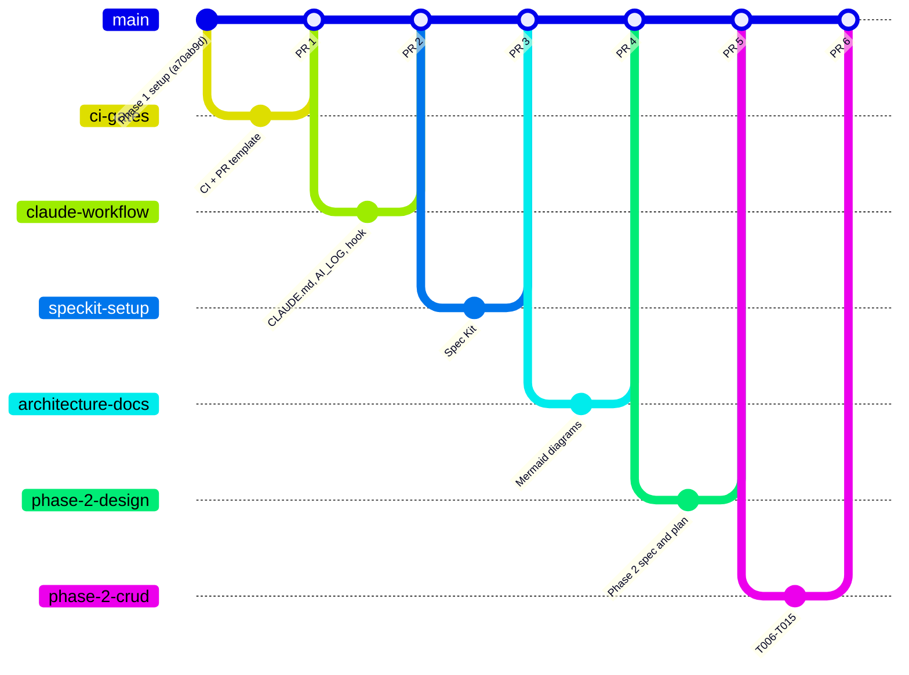

# PaperTrail — Engineering Plan

Status: draft · 2026-11-23

How PaperTrail is built and shipped: the 6-stage AI-native SDLC playbook as the engineering
process, Spec Kit for spec-driven development, Mermaid for design diagrams, Maven/Java 21/Spring
Boot for the app, JUnit 5 + JaCoCo for tests, GitHub for version control and CI, PostgreSQL as
the database.

Source of truth: Spec Kit's `specs/` folder (and `.specify/memory/constitution.md`).
`PAPERTRAIL_SPEC.md` is the stakeholder/customer input: requirements are extracted from it into
Spec Kit files, and it is referenced, not edited, from then on. This file only describes the order
of work and where each check runs.

---

## 1. Decisions

### 1.1 Local vs pipeline

| What | Local (IntelliJ + terminal) | Pipeline (GitHub Actions) |
|---|---|---|
| One test or class while coding | IntelliJ green arrow (JUnit 5) | – |
| Coverage while coding | JaCoCo data in IntelliJ: Run → Show Coverage Data… → `target/jacoco.exec` | – |
| Full gate: compile, all tests, JaCoCo ≥ 80% | `.\mvnw.cmd verify` before every push (Claude runs it too) | `./mvnw -B verify` on every PR and push to main. **The result that counts.** |
| JaCoCo report | `target/site/jacoco/index.html` | `jacoco-report` artifact on the run |
| Testcontainers Postgres | Docker Desktop must be running | Docker preinstalled on `ubuntu-latest` |
| Code review | `/code-review` before opening the PR | Later, optional: Claude review in CI (needs API key) |
| Manual API checks | Swagger UI / `requests.http` against `docker compose up -d db` | – |
| Merge | – | Branch protection: CI green + owner approval |

Rule: same command in both places. IntelliJ gives speed; the pipeline decides.

- Decided: everyone uses the Maven Wrapper that ships with the project — `.\mvnw.cmd` on
  Windows, `./mvnw` in CI and on Linux/macOS. Same Maven version everywhere, nothing to install
  except a JDK. Never a globally installed `mvn`. (`mvnw` is already committed as executable
  with LF line endings, so it runs on the Ubuntu runner.)
- IntelliJ is the workbench (edit, debug, run one test). JaCoCo is the gate, because it runs
  inside Maven and therefore also in CI. Use JaCoCo's numbers only, not IntelliJ's own coverage
  engine, so there is one coverage figure.

### 1.2 Where the pipeline runs

On GitHub's servers, not on the developer PC. Each push or PR starts a fresh Ubuntu VM that
checks out the code, installs Java 21, runs `verify` (with Docker for Testcontainers), uploads
the JaCoCo report and is thrown away. Results show as ✓/✗ on the PR and in the Actions tab.

Cost on GitHub Free: standard runners are free for public repos; private repos include 2,000
minutes/month (Linux counts 1×). One run takes about 2–4 minutes. Going over the quota pauses CI
rather than charging. No self-hosted runner on the PC.

### 1.3 PostgreSQL

| Where | Database |
|---|---|
| Tests (local and CI) | Testcontainers `postgres:16` (`TestcontainersConfiguration`) |
| Running the app locally | `docker compose up -d db` |
| Online (Neon, Supabase, …) | Only if a demo is deployed later — not in the spec |

- No H2 / in-memory DB: NFR-005 (tsvector + GIN) only exists in Postgres.
- No online DB for tests: CI would need network and secrets, and runs would share data.
- Phase 1 tests already start Postgres; Phase 2's `V1__create_schema.sql` is the first schema.

### 1.4 GitHub repo visibility

Decided: **public**. Branch protection works on GitHub Free and standard runners are free.
Consequences: the Crossref contact email in the stakeholder spec is public, nothing secret may be
committed (`.env` is already gitignored), and PRs from forks can't reach repository secrets.

---

## 2. PR sequence

Merge with **squash**, so each PR lands on main as one commit with the PR title as its message.

### Step 0 — GitHub repo (owner, no PR)
- Create an empty repo on github.com (no README, so it doesn't clash with local history).
- `git remote add origin …` and `git push -u origin main` (main = Phase 1 commit `a70ab9d`).
- Install the GitHub CLI (`winget install --id GitHub.cli`) and run `gh auth login`.

### PR 1 · `ci-gates` — Stage 4 Test + Stage 5 Deploy
- `.github/workflows/ci.yml` (the stakeholder spec's YAML, with `./mvnw -B verify`).
- `.github/pull_request_template.md`: FR/T IDs, `verify` output, `/code-review` done, AI_LOG updated.
- Done when this PR's own CI run is green (proves Testcontainers + JaCoCo work on GitHub).
- Then the owner enables branch protection on main: PR required, `build` check required.
- Title: `ci: GitHub Actions build with coverage gate`

### PR 2 · `claude-workflow` — Stage 3 Build + Stage 4 feedback loop
- CLAUDE.md: "Verifying your work" block, "Things Claude gets wrong" section, Git section
  changed from "main for now" to a branch and PR per change.
- `AI_LOG.md` in the spec's format, with the Phase 1 rows.
- `.claude/settings.json` + Python hook that asks before Claude edits an existing test.
- `.gitignore`: `docs/.obsidian/workspace.json`.
- First PR through branch protection and the template.

### PR 3 · `speckit-setup` (owner) — Stage 2 tooling
- `.specify/` and `.claude/skills/speckit-*` as Spec Kit installed them.
- (Done early in PR 2: CLAUDE.md names `specs/` as source of truth, `PAPERTRAIL_SPEC.md` as stakeholder input.)
- The owner extracts requirements from `PAPERTRAIL_SPEC.md` into Spec Kit files (per phase, in
  the `phase-N-design` PRs).

### PR 4 · `architecture-docs` — Stage 2 Design (Mermaid)
- `docs/diagrams.md` (existing), this plan, and `docs/architecture.md`: layer/component
  diagram, ER diagram from the data model, sequence diagram for the FR-002 import.
- GitHub renders Mermaid in `.md` files, so the design review happens in the PR.

### PR 5 · `phase-2-design` (owner) — Stage 2 → 3 handoff
- The owner's Spec Kit artifacts for Phase 2. Merging = approval that starts plan mode.

### PR 6 · `phase-2-crud` — Stage 3 Build + Stage 4 Test
Loop used by every phase PR:
1. Plan mode
2. Implement T006–T015
3. `.\mvnw.cmd verify`
4. `/code-review`
5. Push, CI runs
6. Owner approves
7. Squash-merge with the spec's message: `feat: publication CRUD with validation and error handling`

Also: CRUD part of `requests.http`, new AI_LOG rows.

### PR 7–10 — remaining phases, same pair each
- `phase-3-design` → `phase-3-search` (`feat: full-text search with pagination`)
- `phase-4-design` → `phase-4-import` (`feat: import publication by DOI from Crossref`)

### PR 11 · `readme`
Architecture (links to docs), spec-driven workflow, local/pipeline split, AI_LOG highlights.

### Later (outside the spec today)
FR-007 LLM suggester, Docker image build in CI, hosted Postgres with a demo deploy, Claude
review in CI.

---

## 3. Playbook stage map

| Stage | Started by | Artifact |
|---|---|---|
| 1 Plan | Done (commit `a70ab9d`) | `PAPERTRAIL_SPEC.md` as stakeholder input (the intent); new ideas and bugs later as GitHub Issues |
| 2 Design | PR 3, PR 4, each `phase-N-design` PR | Spec Kit files + Mermaid docs |
| 3 Build | PR 2, used in PR 6, 8, 10 | CLAUDE.md, hook, plan mode |
| 4 Test | PR 1 + PR 2 | `ci.yml`, verify block, JaCoCo gate |
| 5 Deploy | PR 1 | Branch protection, PR template ("deploy" = merge to main) |
| 6 Maintain | PR 2 | AI_LOG → "Things Claude gets wrong" loop; real Stage 6 only once something runs in production |

---

## 4. PR sequence as a git graph

---

## 5. Decisions log

- [x] 2026-11-24 — GitHub repo is **public**
- [x] 2026-11-24 — **Maven Wrapper everywhere** (local, Claude, CI); no global `mvn`
- [x] 2026-11-24 — **Spec Kit `specs/` is the source of truth**; `PAPERTRAIL_SPEC.md` is
  stakeholder/customer input that requirements are extracted from
